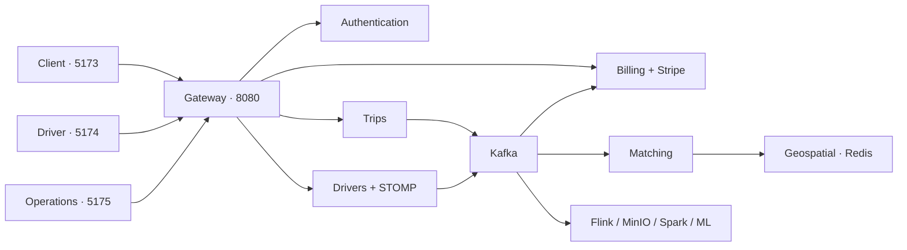

# TaaSim Casablanca

A ride-hailing platform with a Kafka event backbone and a separate Flink/Spark analytics pipeline.



## Run the three-app demo

Requires Java 21, Maven, Node 22+, Docker Desktop's Linux engine and approximately 6 GB free Docker memory. From the repository root in PowerShell:

```powershell
./scripts/start_demo.ps1
```

This packages Java services and builds the frontends in the original **taasim** Docker Compose project. The reversible `docker-compose.app.yml` overlay is merged with the unchanged `docker-compose.yml`; existing `taasim_*` volumes and the original auth/billing database are reused.

```powershell
docker compose -f docker-compose.yml -f docker-compose.app.yml up -d --build
```

The normal app stack includes observability, MinIO and the archiver. Add `-Analytics` to the launcher (or `--profile analytics` to Compose) for Flink, Spark and Jupyter in the same project. Their dashboards move to **18081** (Flink) and **18080** (Spark), leaving 8080/8081 for gateway/auth. Analytics requires additional memory. The old `docker-compose.demo.yml` remains an optional isolated configuration and is not used by this launcher.

The analytics profile also refreshes hourly ride-request counts for the last 48 completed hours. In the Admin App, open **Analytics** to see counts by pickup zone in Casablanca time. The first Spark run downloads connector dependencies.

For a manual run, stop `ride-request-kpi-scheduler` first to avoid overlapping writes. Use whole UTC hour boundaries for a backfill of up to 31 days.

```powershell
docker compose -f docker-compose.yml -f docker-compose.app.yml run --rm ride-request-kpis --from 2026-10-30T00:00:00Z --to 2026-10-31T00:00:00Z
```

Run `node scripts/test_ride_request_kpis.mjs` against a disposable app stack with `kafka-archiver` running to exercise ingestion, Cassandra reads, role checks and replay handling. It creates synthetic requests.

| App | Address | Demo login |
| --- | --- | --- |
| Passenger | http://localhost:5173 | client@taasim.demo |
| Driver | http://localhost:5174 | driver1@taasim.demo |
| Operations | http://localhost:5175 | admin@taasim.demo |

Default demo password: `DemoPassword123!`. These are local demonstration accounts. `seed_demo.ps1 -Password ...` overrides it. Two additional driver accounts are driver2@taasim.demo and driver3@taasim.demo.

### Three-tab walkthrough

1. Open Operations and sign in. Keep Fleet selected.
2. Open Driver. Select **Casablanca demo mode**, then **Go online**. This sends actual backend GPS requests from a desktop outside Casablanca. Browser GPS is available when driving locally.
3. Open Passenger. Click a pickup near the driver's marker and a destination, then request the ride.
4. In Driver, accept the offer and start the ride. Click positions along the map to move the demo taxi. Passenger sees GPS updates over STOMP; Operations sees the fleet position.
5. Complete the ride. Passenger receives the calculated fare; Driver sees earnings; Operations shows the completed trip and fare totals.
6. With Stripe test keys configured, use Stripe Elements to pay. Otherwise checkout explicitly remains unavailable: the app never pretends payment succeeded.
7. Go offline before closing the driver tab. Closing the tab stops its GPS watch; availability currently requires explicit offline action.

The charts show **calculated plus charged fares**, not exclusively settled payments. Driver assignments and trip lookup caches currently depend on a single service instance and do not survive service restart. This is a demo milestone, not a production readiness claim.

### Stripe test setup

Put `STRIPE_SECRET_KEY`, `STRIPE_WEBHOOK_SECRET`, and `VITE_STRIPE_PK` in the repository's ignored `.env`. Rebuild the UI after changing the publishable key. Forward Stripe test events to `/api/billing/stripe/webhook`. Automatic charging defaults off: checkout creates one unconfirmed intent for a persisted billing record and uses a stable per-trip idempotency key. A signed success webhook updates the billing status.

## Develop locally

```powershell
cd frontend
npm ci
npm run dev --workspace=client-app
# In additional terminals from frontend/:
npm run dev --workspace=driver-app
npm run dev --workspace=admin-app
```

The frontend is one npm workspace with one authoritative lockfile at `frontend/package-lock.json`. Shared auth, HTTP, STOMP, map and styling code lives in `frontend/shared`. Do dependency installation from `frontend/`. `VITE_API_BASE` and `VITE_WS_BASE` override the gateway addresses in each app's `.env.local`.

## Validation

```powershell
mvn -B -f backend/pom.xml verify  # unit tests + Docker-backed integration tests
cd frontend
npm ci
npm run lint
npm run build
cd ..
node scripts/test_all_apps.mjs   # full app, role and ownership checks
node scripts/check_infrastructure.mjs # observability/storage readiness
# Full load scenario:
docker run --rm --network host -v "${PWD}/tests/load:/scripts:ro" grafana/k6:1.3.0 run /scripts/full_flow.js
```

`test_all_apps.mjs` checks the three production frontends, seven service health endpoints, role restrictions, cross-user ownership, histories, earnings, reporting, and unconfigured checkout. It runs the real WebSocket/lifecycle smoke first. `check_infrastructure.mjs` verifies MinIO, Grafana, Tempo, Schema Registry and all seven Prometheus targets. These tests add uniquely named synthetic accounts and rides without clearing existing Redis or database data.

`smoke_demo.mjs` registers isolated accounts and verifies dispatch, accept/start/complete, GPS, fare creation, earnings, admin reporting, role rejection and offline behavior. k6 separately measures request and status endpoints: 20 virtual users, request p95 <800 ms, status p95 <200 ms, HTTP failures <1%. It does not simulate payment or claim to load-test full dispatch. Results must be measured on the target environment; no performance numbers are fabricated.

GitHub Actions runs backend tests/container builds, all three frontend builds, and an end-to-end workflow against the original stack and overlay with the full 20-user k6 scenario. Logs are retained as workflow artifacts. The existing auth integration test now runs in Maven's `verify` phase through Failsafe.

### Measured CI load result — October 30, 2026

The full 20-user scenario passed on GitHub's Ubuntu runner (revision `13ad111`):

| Metric | Measured | Threshold |
| --- | --- | --- |
| Trip request p95 | 14.33 ms | <800 ms |
| Trip status p95 | 8.48 ms | <200 ms |
| HTTP failure rate | 0% | <1% |
| Checks passed | 1,822 / 1,822 | >99% |

The run includes a 30-second ramp, one minute at 20 users, and a 30-second ramp-down. These are CI measurements for request/status APIs; they do not measure card settlement or guarantee laptop/VPS performance. The workflow retains its JSON summary and container logs.

## Deployment is deferred

No deployment is performed by this change. `deploy-on-tag.yml` is guarded by `DEPLOY_ENABLED=true` and a production environment; it stays skipped by default. Before enabling it, configure SSH credentials, a verified SSH host key, `.env`, public frontend API/WebSocket build URLs, image availability, a domain and HTTPS. `deploy/deploy.sh` combines the demo infrastructure compose with the complete GHCR image overlay, without deleting data volumes.

## Analytics pipeline

The original `docker-compose.yml` plus `docker-compose.app.yml` runs the app, storage and observability in one `taasim` project. The optional analytics profile adds Flink and Spark/Jupyter without conflicting ports. Source directories contain:

- `src/simulators`: Kafka GPS and trip generators.
- `src/flink`: GPS normalization, demand aggregation and legacy matching.
- `src/archiver`: Kafka-to-MinIO batches.
- `src/spark`: Porto/Casablanca mapping, ETL, KPIs and GBT demand forecasting.
- `src/api`: earlier FastAPI analytics serving layer.

Do not run the legacy Flink trip matcher alongside the Spring matching service against the same operational topics. Forecast-to-pricing integration remains a future feature.

## Roadmap status

Slices 23 and 24 have driver/admin UI implementations and backend support. Slice 25 supplies the demo launcher, seeds, full-flow smoke, k6, CI and deferred deployment assets. The browser walkthrough and 20-user benchmark have passed; a real Stripe card confirmation and future VPS deployment still require their configured environments. The local `0_plans` directory contains the original detailed plans; ignored files remain local unless explicitly added.
